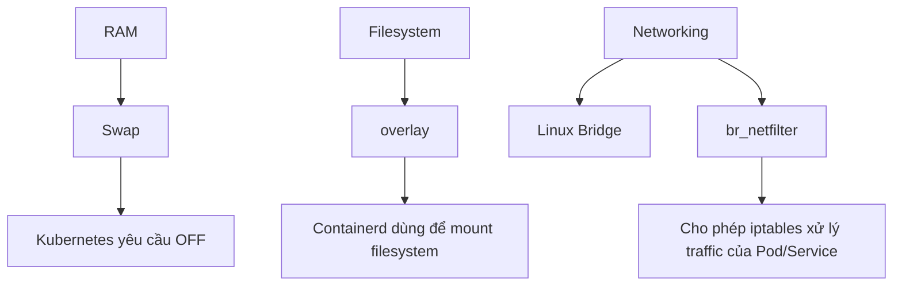
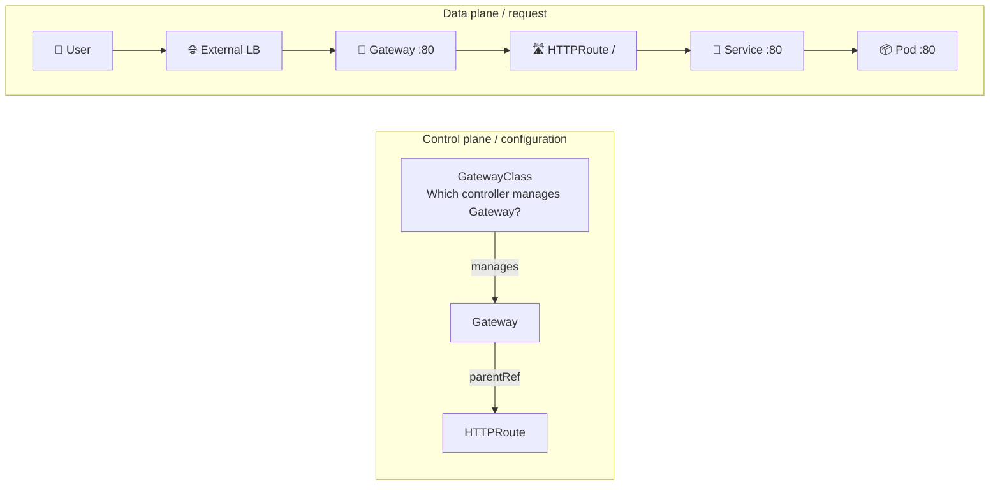

## Syllabus
### Domain 1: 
1. PV is cluster-scoped (no namespace). PVC is namespace-scoped
2. A PV is the actual storage (think: the hard drive). A PVC is a request for that storage (think: "I need 2Gi of disk"). A StorageClass tells Kubernetes how to dynamically create PVs when a PVC asks for one.
3. PVC binds to a PV when: capacity >= request, accessModes match, AND storageClassName matches. If any one of these is off, the PVC sits in Pending forever with no helpful error message.

**Access Modes** — know these four-letter abbreviations:

| Mode | Short | What it actually means |
| --- | --- | --- |
| ReadWriteOnce | RWO | One node can mount read-write. This is what you'll use 90% of the time. |
| ReadOnlyMany | ROX | Many nodes can mount read-only. Rarely comes up on the exam. |
| ReadWriteMany | RWX | Many nodes can mount read-write. Doesn't work with hostPath. |
| ReadWriteOncePod | RWOP | Only one pod can mount read-write. New in v1.29+, might show up. |

**Reclaim Policies** — know the difference or you'll lose data:

| Policy | What actually happens |
| --- | --- |
| Retain | The PV survives PVC deletion. Data is safe, but you must manually clean up the PV before it can be reused. |
| Delete | The PV and underlying storage are deleted. This is the default for most cloud StorageClasses. Be careful. |
| Recycle | Deprecated. Don't use it or memorize it. |

**Volume Modes:**

- **Filesystem** (default) — mounted as a directory.
- **Block** — a raw block device with no filesystem.

On the exam: know the difference between **Retain** and **Delete**. If the question says data should persist after PVC deletion, use **Retain**.

!!! warning "Pod Readiness Proves Storage Works"
    "PVC is Bound" looks good on paper, but until you attach a Pod and it becomes Running, you haven't proven the storage actually works. A Pod staying Pending means either: (a) the PVC isn't Bound, (b) the hostPath doesn't exist on the node, (c) permissions are wrong, or (d) scheduling constraints prevent placement. Always verify the consumer Pod reaches Running state — that's your real test.

!!! warning "hostPath Directory Must Exist on Node"
    Created PV with `hostPath: /data/exercise-12` but forgot to `mkdir -p /data/exercise-12` on the node. Pod stayed Pending. The node has to have the backing directory, and if running on a multi-node cluster, the Pod might land on a node that doesn't have it. Consider this when designing storage tests.

### Domain 2: Troubleshoots
1. Check container crashed: k logs <pod-name> --previous                 # crashed container — you'll use this a lot
2. Check certificated cluster expired: sudo kubeadm certs check-expiration

3. Check ETCD healthy: ETCDCTL_API=3 etcdctl endpoint health \
  --endpoints=https://127.0.0.1:2379 \
  --cacert=/etc/kubernetes/pki/etcd/ca.crt \
  --cert=/etc/kubernetes/pki/etcd/server.crt \
  --key=/etc/kubernetes/pki/etcd/server.key

4. ls /etc/kubernetes/manifests/  # Should have: etcd.yaml, kube-apiserver.yaml, kube-controller-manager.yaml, kube-scheduler.yaml

5. Troubleshoot Networking — Service not reachable? Work through this:

```bash
# 1. Does the service exist and have the right selector?
k get svc <service>
k describe svc <service>

# 2. Does the service have endpoints?
k get endpoints <service>
# If empty: selector doesn't match any running pod

# 3. Is the pod actually running on the target port?
k exec <pod> -- wget -qO- localhost:<port>

# 4. DNS working?
k run test-dns --image=busybox:1.36 --rm -it -- nslookup <service-name>

# 5. Is kube-proxy running?
k get pods -n kube-system -l k8s-app=kube-proxy

# 6. NetworkPolicy blocking traffic?
k get networkpolicy -n <namespace>
```

The most common networking issues on the exam:

- Service selector doesn't match pod labels (typo in labels)
- Service targetPort doesn't match container port
- NetworkPolicy denying traffic (remember: any policy = deny by default for that pod)
- CoreDNS down or misconfigured
- kube-proxy not running on a node

### Domain 3: Workloads, Scheduling
1. Deployments manage ReplicaSets, which manage Pods
1. Pod/Container just has containerPort. Service has port and targetPort
2. ConfigMaps hold non-sensitive config. Secrets hold sensitive data (base64-encoded, not encrypted by default)
3. Three ways to inject ConfigMap/Secret into a pod:

- Env vars (all keys at once):

```yaml
envFrom:
- configMapRef:
    name: app-config
- secretRef:
    name: db-creds
```

- Single key as one env var:

```yaml
env:
- name: DATABASE_USER
  valueFrom:
    secretKeyRef:
      name: db-creds
      key: DB_USER
```

- Mounted as files (each key becomes a file in the mount path):

```yaml
volumeMounts:
- name: config-vol
  mountPath: /etc/config
volumes:
- name: config-vol
  configMap:
    name: app-config
```
4. If you set resource limits without requests, requests default to limits.
5. Schedule pods on specific nodes — three mechanisms:

- `nodeSelector` — simplest, exact label match:

```yaml
spec:
  nodeSelector:
    disk: ssd
```

- Node affinity — more flexible, supports expressions (`In`, `NotIn`, etc.):

```yaml
spec:
  affinity:
    nodeAffinity:
      requiredDuringSchedulingIgnoredDuringExecution:
        nodeSelectorTerms:
        - matchExpressions:
          - key: disk
            operator: In
            values:
            - ssd
```

- Taints (on nodes) + tolerations (on pods) — repels pods instead of attracting them:

```bash
k taint nodes node1 gpu=true:NoSchedule    # taint
k taint nodes node1 gpu=true:NoSchedule-   # remove
```

```yaml
spec:
  tolerations:
  - key: "gpu"
    operator: "Equal"
    value: "true"
    effect: "NoSchedule"
```

Effects: `NoSchedule` (block new pods) · `PreferNoSchedule` (soft avoid) · `NoExecute` (also evicts existing pods).
6. Static pods: managed directly by the kubelet on a node (not by the API server/scheduler). The kubelet watches a directory and auto-creates/restarts a pod for every manifest file dropped there.

- Default manifest directory is usually `/etc/kubernetes/manifests/`, but it's **not guaranteed** — it's whatever the kubelet is configured with.

!!! warning "Verify the actual staticPodPath"
    Forgot to check the actual path on the node. Placed the manifest in the "usual" spot, but the kubelet was configured to look elsewhere. Always verify:

    ```bash
    cat /var/lib/kubelet/config.yaml | grep staticPodPath
    ```

    Paths are configurable and exam clusters might differ from defaults. A typo in the path means the pod never appears — and the kubelet won't error loudly about it, so it's easy to miss.

### Domain 4 — Cluster Architecture, Installation & Configuration
1. RBAC has four objects:

| Object | Scope | Binds to |
|---|---|---|
| Role | Namespace | RoleBinding |
| ClusterRole | Cluster-wide | ClusterRoleBinding or RoleBinding |
| RoleBinding | Namespace | Role or ClusterRole |
| ClusterRoleBinding | Cluster-wide | ClusterRole |
2. Test permissions RBAC: k auth can-i list pods -n dev --as=system:serviceaccount:dev:my-sa
3. Use kubeadm to install a basic cluster:

```bash
# On control plane node:
sudo kubeadm init --pod-network-cidr=10.244.0.0/16

# Set up kubeconfig
mkdir -p $HOME/.kube
sudo cp /etc/kubernetes/admin.conf $HOME/.kube/config
sudo chown $(id -u):$(id -g) $HOME/.kube/config

# Install CNI (e.g., Calico)
k apply -f https://docs.projectcalico.org/manifests/calico.yaml

# On worker nodes:
sudo kubeadm join <control-plane-ip>:6443 --token <token> --discovery-token-ca-cert-hash sha256:<hash>
```

Lost the join command? Regenerate it: `kubeadm token create --print-join-command`
4. Node prerequisites — check in this order when a node won't join, `kubeadm init/join` fails, or kubelet won't start:

| Vấn đề | Kiểm tra | Cách sửa |
|---|---|---|
| Container runtime không chạy | `systemctl status containerd` | `systemctl start containerd` |
| Swap bật | `swapon --show` | `swapoff -a` |
| Thiếu module overlay | `lsmod \| grep overlay` | `modprobe overlay` |
| Thiếu module br_netfilter | `lsmod \| grep br_netfilter` | `modprobe br_netfilter` |
| Sai sysctl | `sysctl net.bridge.bridge-nf-call-iptables` | `sysctl -w net.bridge.bridge-nf-call-iptables=1` |

These are the most common OS-level misconfigurations the exam (or real environments) use to break node bootstrapping.


5. Upgrade on a Kubernetes Cluster Using Kubeadm 4.5
6. ETCD Backup Key difference: control plane uses kubeadm upgrade apply, worker uses kubeadm upgrade node
7. Where to find the cert paths: cat /etc/kubernetes/manifests/etcd.yaml and look for --cert-file, --key-file, --trusted-ca-file.

### Domain 5 - Services & Networking
1. Networking in Kubernetes "just works" if your CNI is installed correctly. Don't overthink the model — pods get IPs, pods can talk to each other, nodes can talk to pods. The CNI plugin (Calico, Flannel, Cilium) makes it happen
2. Same-node pods talk through a bridge, cross-node pods go through the CNI overlay
```bash
# Test pod-to-pod connectivity
k exec pod-a -- wget -qO- --timeout=2 http://<pod-b-ip>
```
3. The most important thing: port is what clients use to reach the service. targetPort is the port the container listens on. nodePort is the port on the node (NodePort/LoadBalancer only)
4. CoreDNS is the cluster DNS server (replaced kube-dns a long time ago). It runs as a Deployment in kube-system
5. Critical gotcha on the exam: if you add an Egress policy, you must also allow DNS (UDP 53). Otherwise the pod can't resolve any service names and everything looks broken even though the policy is "correct."

## Time Allocation

| Question Type | Typical Time | Notes |
| --- | --- | --- |
| Create a pod/deployment | 2-3 min | Use `$do` to generate YAML |
| Create RBAC resources | 3-5 min | Know the imperative commands |
| NetworkPolicy | 5-8 min | Always allow DNS egress |
| etcd backup/restore | 8-10 min | Know the cert paths |
| kubeadm upgrade | 8-10 min | Follow the sequence exactly |
| Troubleshoot broken node | 5-8 min | Check kubelet first |
| Troubleshoot networking | 5-8 min | Check endpoints, selectors |
| PV/PVC/StorageClass | 4-6 min | Match accessModes and storageClassName |
| DaemonSet | 3-4 min | Copy from docs fast |
| Ingress/Gateway | 4-6 min | Know ingressClassName |
| Static pod | 3-4 min | Write manifest directly to `/etc/kubernetes/manifests/` |
| Node drain/cordon | 2-3 min | `--ignore-daemonsets --delete-emptydir-data` |

## Notes

### Exam tips

- Cần mẫu YAML (ví dụ sidecar): copy từ docs rồi sửa — tìm "sidecar containers" trên kubernetes.io.
- `kubectl patch` — sửa nhanh 1 field của resource đang chạy mà không cần sửa lại cả YAML:

```bash
# Cú pháp tổng quát
k patch <resource-type> <name> -p '{"spec":{"template":{"spec":{"FIELD":"VALUE"}}}}'

# Ví dụ: patch priorityClassName vào Deployment
k patch deployment <name> \
  -p '{"spec":{"template":{"spec":{"priorityClassName":"high-priority"}}}}'
```

- Troubleshooting

| Problem | Kiểm tra đầu tiên |
| --- | --- |
| Node NotReady | `systemctl status kubelet` |
| Kubelet lỗi | `journalctl -u kubelet` |
| DNS không resolve | `cat /etc/resolv.conf` |
| Test DNS | `nslookup kubernetes` |
| CoreDNS | `k get pods -n kube-system` |
| kube-proxy | `k get ds -n kube-system \| grep proxy` |
| Service networking | `iptables-save \| grep <service>` |
| Audit | `kube-apiserver.yaml` |
| Tìm delete event | `grep 'verb.*delete' audit.log` |

- Test networking:

```bash
k run test1 --image=busybox:1.36 -- sleep 3600
k run test2 --image=busybox:1.36 -- sleep 3600

# Get IPs
POD1=$(k get pod test1 -o jsonpath='{.status.podIP}')
POD2=$(k get pod test2 -o jsonpath='{.status.podIP}')

# Test connectivity
k exec deploy/test1 -- ping -c 1 $POD2
```

- Troubleshoot etcd — cluster is broken, API server won't start:

```bash
# 1. Check kube-apiserver pod logs → tìm lỗi (ví dụ: sai etcd endpoint IP/port)
k logs -n kube-system kube-apiserver-<node> --previous

# 2. SSH vào control plane node, sửa etcd endpoint
vi /etc/kubernetes/manifests/kube-apiserver.yaml
# sửa flag --etcd-servers=

# 3. Verify IP/port khớp với etcd manifest
cat /etc/kubernetes/manifests/etcd.yaml

# 4. Save → kubelet tự restart static pod API server

# 5. Verify cluster healthy
k get nodes
k get pods -A
```

Dấu hiệu cluster healthy: `k get nodes` chạy được, `k get pods -A` chạy được, API server pod ở trạng thái `Running`.

### ConfigMap / Secret

- Dùng `envFrom` để load tất cả key từ ConfigMap hoặc Secret thành biến môi trường.
- Dùng `volumes` + `volumeMounts` để mount ConfigMap thành file.

#### envFrom vs env.valueFrom

- `envFrom`: load TẤT CẢ key của ConfigMap/Secret thành biến môi trường (tên biến = tên key).
- `env.valueFrom.configMapKeyRef` (hoặc `secretKeyRef`): load MỘT key duy nhất, và có thể đổi tên biến.
- Trong đề thi:
  - Nếu đề nói "load all keys" → dùng `envFrom`.
  - Nếu đề nói "load KEY_X as MY_VAR" → dùng `valueFrom`.
- Dùng ngược nhau sẽ KHÔNG báo lỗi, chỉ ra sai tên biến → dễ mất điểm mà không biết.

### CNI

Install CNI (ví dụ Calico) — các bước/hints hay dùng:

```bash
# Get cluster CIDR
k describe cm kubeadm-config -n kube-system | grep pod-network-cidr

# Alternative (nếu không có configmap)
ps aux | grep kube-controller-manager | grep cidr

# Wait for CNI pods ready
k get pods -n calico-system -w

# Test pod networking
k run test --image=busybox:1.36 --rm -it -- ping <pod-ip>
```

Tigera (Calico) docs: https://docs.tigera.io/calico/latest/getting-started/kubernetes/self-managed-onprem/onpremises

### Kubeadm Upgrade

Bài này chủ yếu cần nhớ sequence nâng Kubernetes cluster bằng kubeadm. Với CKA, quan trọng nhất là phân biệt control plane và worker.

#### 1. Ý tưởng tổng quát

Ví dụ cluster đang `v1.34.x`, muốn nâng lên `v1.35.x`. Luôn theo nguyên tắc:

```
CONTROL PLANE
     ↓
WORKER 1
     ↓
WORKER 2
     ↓
...
```

Không nâng worker trước control plane.

#### 2. Control Plane upgrade

Sequence cần thuộc:

```
kubeadm package
    ↓
kubeadm upgrade plan
    ↓
kubeadm upgrade apply v1.35.x
    ↓
kubelet + kubectl package
    ↓
systemctl daemon-reload
    ↓
systemctl restart kubelet
```

**Bước 1 — kiểm tra version**

```bash
k get nodes
kubeadm version
```

Ví dụ:

```
NAME           STATUS   ROLES           VERSION
controlplane   Ready    control-plane   v1.34.2
node01         Ready    <none>          v1.34.2
```

**Bước 2 — upgrade kubeadm** (trên control plane)

```bash
apt update
apt install kubeadm='1.35.x-*'
kubeadm version
```

Lúc này kubeadm đã là version mới nhưng cluster chưa upgrade.

**Bước 3 — xem upgrade có khả dụng không**

```bash
kubeadm upgrade plan
```

Nó cho bạn biết cluster hiện tại là gì và có thể upgrade lên version nào. Ví dụ:

```
Components that must be upgraded manually:
COMPONENT   CURRENT   TARGET
kubelet     1.34.x    1.35.x
```

**Bước 4 — upgrade control plane**

Đây là command cực kỳ quan trọng:

```bash
kubeadm upgrade apply v1.35.x
```

Control plane → `apply`. Sau bước này, các Kubernetes control-plane components được nâng cấp.

**Bước 5 — upgrade kubelet + kubectl**

```bash
apt install kubelet='1.35.x-*' kubectl='1.35.x-*'

systemctl daemon-reload
systemctl restart kubelet
```

!!! warning "CKA trap"
    Đừng chỉ `systemctl restart kubelet`. Mà phải:

    ```bash
    systemctl daemon-reload
    systemctl restart kubelet
    ```

    Vì package mới có thể thay đổi systemd unit file. Có thể nhớ: **Package changed → daemon-reload → restart**.

#### 3. Worker upgrade

Worker có sequence khác control plane một chút. Phải thuộc:

```
drain
  ↓
upgrade kubeadm
  ↓
upgrade kubelet + kubectl
  ↓
kubeadm upgrade node
  ↓
daemon-reload
  ↓
restart kubelet
  ↓
uncordon
```

**Bước 1 — Drain worker** (từ control plane)

```bash
kubectl drain node01 --ignore-daemonsets
```

Mục đích là di chuyển workload ra khỏi worker trước khi ta restart/upgrade nó. Đây là lý do drain phải xảy ra trước upgrade.

**Bước 2 — SSH vào worker**

```bash
ssh node01

apt update
apt install kubeadm='1.35.x-*'
apt install kubelet='1.35.x-*' kubectl='1.35.x-*'
```

**Bước 3 — kubeadm upgrade node**

Đây là điểm rất dễ nhầm:

| | Control plane | Worker |
| --- | --- | --- |
| Command | `kubeadm upgrade apply v1.35.x` | `kubeadm upgrade node` |

Worker **KHÔNG** dùng `apply`.

**Bước 4 — restart kubelet**

```bash
systemctl daemon-reload
systemctl restart kubelet
```

**Bước 5 — quay lại control plane và uncordon**

```bash
kubectl uncordon node01
```

Node quay lại trạng thái có thể nhận workload.

#### 4. Full workflow cần thuộc lòng

Giả sử cluster có `controlplane`, `node01`, `node02`, upgrade từ `1.34 → 1.35`.

Control plane:

```bash
apt update
apt install kubeadm='1.35.x-*'

kubeadm upgrade plan
kubeadm upgrade apply v1.35.x

apt install kubelet='1.35.x-*' kubectl='1.35.x-*'

systemctl daemon-reload
systemctl restart kubelet
```

Worker 1 (từ control plane rồi SSH vào worker):

```bash
# Control plane
kubectl drain node01 --ignore-daemonsets

# SSH vào worker
apt update
apt install kubeadm='1.35.x-*'
apt install kubelet='1.35.x-*' kubectl='1.35.x-*'

kubeadm upgrade node

systemctl daemon-reload
systemctl restart kubelet
```

Quay lại control plane:

```bash
kubectl uncordon node01
```

Sau đó làm tương tự với `node02`.

#### 🧠 CKA cheat sheet Upgrade Kubernetes

Nếu vào CKA gặp "Upgrade Kubernetes cluster from X to Y", nghĩ ngay:

```
CONTROL PLANE
────────────────────────────
1. apt update
2. upgrade kubeadm
3. kubeadm upgrade plan
4. kubeadm upgrade apply v1.35.x
5. upgrade kubelet + kubectl
6. daemon-reload
7. restart kubelet


WORKER
────────────────────────────
1. kubectl drain NODE
2. upgrade kubeadm
3. upgrade kubelet + kubectl
4. kubeadm upgrade node
5. daemon-reload
6. restart kubelet
7. kubectl uncordon NODE


VERIFY
────────────────────────────
kubectl get nodes
```

**Câu thần chú để nhớ:**

- Control plane: plan → apply
- Worker: drain → node → uncordon
- Package đổi → daemon-reload → restart
- Control plane trước → worker từng node một.

### HPA vs VPA

- **HPA** (Horizontal Pod Autoscaler): scale **số lượng replicas** theo metric (CPU/memory). CPU vượt target → tạo thêm pod, load giảm → giảm pod.
- **VPA** (Vertical Pod Autoscaler): chỉnh **requests/limits** của pod hiện có theo usage thực tế (không đổi số replicas) — tối ưu bin-packing, giảm lãng phí.
- CKA chỉ test **HPA**, nhưng hiểu VPA giúp tư duy resource efficiency.

**Setup nhanh:**

```bash
k autoscale deployment load-app --cpu-percent=50 --min=1 --max=5
```

**Pre-flight checklist (giải quyết 80% lỗi HPA):**

```bash
# 1. metrics-server đang chạy?
k get deployment -n kube-system metrics-server

# 2. kubectl top có hoạt động?
k top nodes
k top pods -n <ns>          # "metrics not available" → chờ ~60s

# 3. Deployment có resource requests chưa?
k get deployment load-app -o json | jq '.spec.template.spec.containers[0].resources'
# {} rỗng → đây là lý do HPA hiện <unknown>

# 4. HPA đang watch đúng target.type chưa?
k get hpa -o yaml | grep -A5 "metrics:"
# Phải là type: Utilization (KHÔNG phải AverageValue)

# 5. HPA có metric hợp lệ chưa?
k get hpa     # TARGETS phải là "x%/50%", không phải "<unknown>/50%"
```

**Target type dễ nhầm:**

| Type | Ý nghĩa |
| --- | --- |
| `type: Utilization` + `averageUtilization: 50` | Scale khi CPU dùng = 50% so với **request** (ví dụ request 100m, dùng 50m → 50%). Đây là cái đề thi hay test. |
| `type: Value` + `averageValue: 50m` | Scale khi pod dùng đúng 50m CPU tuyệt đối. Ít gặp hơn. |

!!! warning "Những cái từng bị dính"
    - **Thiếu resource requests → metric `<unknown>`**: HPA tính % dựa trên CPU **request**, không có request = không có baseline. Luôn set `resources.requests.cpu` cho pod cần autoscale.
    - **`target.type: AverageValue` thay vì `Utilization`**: metrics-server không tính được AverageValue cho CPU (đó là cho custom metrics) → HPA đứng im ở `<unknown>`. Với CPU phải dùng `Utilization`.
    - **Scale-down chậm là bình thường**: mặc định HPA đợi ~5 phút sau khi load giảm mới scale down (tránh flapping) — không phải bug.
    - **metrics-server không tự có sẵn trên kubeadm cluster**: nếu `k top pods` lỗi, cài bằng `k apply -f https://github.com/kubernetes-sigs/metrics-server/releases/latest/download/components.yaml`.

## Alternative

### GatewayClass

`GatewayClass` không phải một bước request đi qua — nó nằm **ngoài luồng request**, chỉ xác định Gateway Controller nào quản lý `Gateway`.



**Mà nhớ theo 2 luồng riêng:**

- Control plane: `GatewayClass → (manages) → Gateway → (parentRef) → HTTPRoute`
- Data plane (request thực tế): `👤 User → 🌐 LB → 🚪 Gateway → 🛣️ HTTPRoute → 🔌 Service → 📦 Pod`

!!! tip "Điểm quan trọng nhất"
    `GatewayClass` xác định **Gateway Controller** nào sẽ quản lý `Gateway` đó — nó không tham gia vào đường đi của request thực tế.

### kubectl debug

`kubectl debug` dùng để troubleshoot Pod đang chạy hoặc debug trực tiếp Node. Có 2 loại cần phân biệt rõ.

#### 1. Debug Pod

```bash
k create ns exercise-17
k run broken-app -n exercise-17 --image=nginx:1.27

# Attach debug container
k debug broken-app -n exercise-17 -it --image=busybox:1.36 --target=broken-app
```

Trong debug container, chạy `ps aux` — phải thấy process của nginx.

!!! tip "⭐ `--target` là bắt buộc"
    - Không có `--target` → debug container có process namespace riêng → **không** thấy process nginx.
    - Có `--target=broken-app` → debug container **share process namespace** với container đó → thấy process nginx.
    - Câu nhớ: `--target` = "Tôi muốn debug process của container nào?"

#### 2. Debug Node

```bash
k debug node/<node-name> -it --image=busybox:1.36
```

Trong debug container, filesystem của Node được mount tại `/host`:

```bash
ls /host
chroot /host          # giờ đang ở filesystem Node thật
systemctl status kubelet
```

!!! tip "⭐ `chroot /host` là bắt buộc"
    - Không `chroot /host` → chỉ thấy filesystem của **debug container**, không phải Node.
    - `chroot /host` → biến `/host` (kubelet, systemd, `/etc`, `/var`, ...) thành root filesystem hiện tại.
    - Câu nhớ: `/host` = filesystem Node → `chroot /host` = đổi root sang Node thật.

#### 3. So sánh 2 loại debug

| | Pod Debug | Node Debug |
| --- | --- | --- |
| Command | `k debug <pod>` | `k debug node/<node>` |
| Mục đích | Debug container | Debug Node |
| Quan trọng nhất | `--target` | `chroot /host` |
| Kiểm tra | `ps aux` | `systemctl status kubelet` |
| Network | Network namespace của Pod | Network namespace của Node |

#### 4. Network namespace cũng khác nhau

- **Pod debug**: đang ở network namespace của Pod → `curl localhost:80` kiểm tra nginx trong Pod.
- **Node debug**: `localhost` lúc này là **Node**, không phải Pod. Muốn test Service/Pod phải dùng IP cụ thể: `curl <service-ip>` hoặc `curl <pod-ip>:80`.

!!! warning "CKA Traps"
    - **Trap 1 — Quên `--target`**: `k debug broken-app -it --image=busybox:1.36` chạy được nhưng không thấy nginx process.
    - **Trap 2 — Quên `chroot /host`**: `k debug node/node01 -it --image=busybox:1.36` → vẫn đang ở filesystem của debug container, phải `chroot /host` mới đúng.
    - **Trap 3 — Pod nhiều container**: `--target=container-a` chỉ share process namespace với `container-a`, không phải toàn bộ Pod.
    - **Trap 4 — Image chưa có sẵn**: `--image=busybox:1.36` có thể phải pull; nếu node không có internet/cache thì debug container có thể không start.

**Câu thần chú:** `Pod = --target` · `Node = chroot /host`

### Pod Security Standards (PSS)

**1. PSS là gì?**

PSS (Pod Security Standards) = bộ tiêu chuẩn quy định Pod được phép chạy với mức quyền nào. Kubernetes dùng **Pod Security Admission (PSA)** để kiểm tra Pod theo PSS.

**2. PSS có 3 LEVEL**

| Level | Mức độ | Ý nghĩa |
| --- | --- | --- |
| `privileged` | 🔓 Thấp nhất | Gần như không hạn chế |
| `baseline` | 🟡 Trung bình | Chặn các cấu hình nguy hiểm phổ biến |
| `restricted` | 🔴 Cao nhất | Hardening mạnh, yêu cầu Pod an toàn hơn |

Nhớ: `privileged → baseline → restricted` (ít → nhiều security).

**3. PSS có 3 MODE**

Mode quyết định Kubernetes làm gì khi Pod vi phạm policy.

| Mode | Khi vi phạm |
| --- | --- |
| `enforce` | ❌ **BLOCK** Pod |
| `audit` | 📝 Cho chạy + **RECORD** violation |
| `warn` | ⚠️ Cho chạy + **TELL** user |

**4. LEVEL ≠ MODE** — rất dễ nhầm trong CKA

```yaml
pod-security.kubernetes.io/enforce: restricted
#                           ^mode     ^level
```

- `enforce` = **MODE** (xử lý violation như thế nào?)
- `restricted` = **LEVEL** (policy nghiêm đến đâu?)

**5. Namespace là nơi cấu hình PSS**

```yaml
apiVersion: v1
kind: Namespace
metadata:
  name: secure-ns
  labels:
    pod-security.kubernetes.io/enforce: restricted
```

Có thể cấu hình cả 3 mode cùng lúc:

```yaml
labels:
  pod-security.kubernetes.io/enforce: restricted
  pod-security.kubernetes.io/audit: restricted
  pod-security.kubernetes.io/warn: restricted
```

!!! warning "Prefix phải chính xác"
    Phải là `pod-security.kubernetes.io/`, **không phải** `pod-security/`.

**6. `privileged` có 2 nghĩa khác nhau — trap quan trọng**

- **PSS level**: `pod-security.kubernetes.io/enforce: privileged` → policy gần như không hạn chế.
- **Container securityContext**: `securityContext.privileged: true` → yêu cầu container chạy với quyền privileged.

Hai cái này **không phải một**.

**7. Ví dụ**

Namespace: `pod-security.kubernetes.io/enforce: baseline`. Pod có `securityContext.privileged: true`.

```
Pod → PSA → Namespace policy = baseline → privileged: true?
  → ❌ Vi phạm baseline → enforce → ❌ Pod bị reject
```

**8. `audit` không có nghĩa là block**

Namespace chỉ có `pod-security.kubernetes.io/audit: restricted` (không có `enforce`):

```
Pod → PSA → restricted violation → audit → ✅ Pod vẫn được tạo, 📝 violation được ghi nhận
```

!!! warning "Trap trong lab"
    Nếu Namespace có **cả** `enforce: restricted` **và** `audit: restricted`, Pod vi phạm vẫn **bị block** bởi `enforce`. Muốn test audit-only thì không được có `enforce` chặn nó.

**9. `restricted` thường yêu cầu Pod hardening**

```yaml
securityContext:
  runAsNonRoot: true
  allowPrivilegeEscalation: false
  readOnlyRootFilesystem: true
```

Ngoài ra còn các yêu cầu khác (capabilities, seccomp...) và có thể thay đổi theo Kubernetes/PSS version.

!!! warning
    Khi gặp câu hỏi yêu cầu exact requirement của `restricted`, kiểm tra đúng version Kubernetes.

**10. PSS kiểm tra ở đâu?**

Policy nằm ở **Namespace** (qua labels), nhưng PSA kiểm tra cấu hình thực tế của **Pod/container** (securityContext, capabilities, privilege, ...).

**11. Pod đang chạy (existing Pod)**

PSS chủ yếu áp dụng khi Pod được **create/update**. Nếu Namespace đổi policy, Pod đang chạy **không tự nhiên bị kill**. Muốn test lại policy: `k delete pod <pod>` rồi tạo lại.

!!! tip "CKA cheat sheet"
    - **LEVEL** = nghiêm đến đâu? → `privileged` / `baseline` / `restricted`
    - **MODE** = violation xử lý thế nào? → `enforce` (BLOCK) / `audit` (RECORD) / `warn` (TELL)
    - Câu thần chú: **LEVEL = How strict? · MODE = What to do?**
    - Và đặc biệt: `privileged` level **≠** `securityContext.privileged: true` — 2 thứ khác nhau.

### PriorityClass

```
PriorityClass
│
├── value
│     └── số càng lớn → priority càng cao
│
├── preemptionPolicy
│     ├── PreemptLowerPriority → có thể đuổi Pod thấp hơn
│     └── Never                → không preempt
│
└── priorityClassName
      └── gán vào Pod
```

!!! warning "Chọn value sai khi đề yêu cầu \"high priority\""
    Dùng `value` thấp (ví dụ `100`) khi đề nói "high priority". Thang giá trị thực tế:

    | Priority | Value |
    | --- | --- |
    | `system-cluster-critical` | 2000000000 |
    | `system-node-critical` | 2000001000 |
    | User-defined (thường) | 0 – 1000000 |

    Nên chọn `value` gần mức tối đa cho user-defined (ví dụ `999999`) để đảm bảo Pod được schedule trước, ngay cả khi cluster đang thiếu resource — vì scheduler chọn ưu tiên theo giá trị tuyệt đối, không phải "cao" theo cảm tính.

### Troubleshoot etcd — 5 gotcha quan trọng

**1. Sai IP → đừng đoán IP đúng**

Nếu `kube-apiserver` đang trỏ etcd sai (`--etcd-servers=https://10.x.x.x:2379`), **không tự đoán IP**. Kiểm tra etcd thật sự đang listen ở đâu:

```bash
grep "listen-client-urls" /etc/kubernetes/manifests/etcd.yaml
```

`etcd.yaml` = source of truth.

**2. Static Pod → không dùng `kubectl apply`**

`etcd` và `kube-apiserver` trong kubeadm thường là **Static Pod**, manifest nằm ở `/etc/kubernetes/manifests/` (`etcd.yaml`, `kube-apiserver.yaml`). Sửa trực tiếp:

```bash
sudo vi /etc/kubernetes/manifests/etcd.yaml
```

```
edit manifest → kubelet detects → restart static pod
```

Nếu sửa rồi mà vài giây vẫn chưa restart: `sudo systemctl restart kubelet`.

**3. Port etcd → nhớ 2379, không phải 2380**

Bẫy rất hay gặp: `2379` → client, `2380` → peer.

```bash
# ✅ đúng
--etcd-servers=https://127.0.0.1:2379

# ❌ sai — đây là port peer
--etcd-servers=https://127.0.0.1:2380
```

Kiểm tra: `grep "listen-client-urls" /etc/kubernetes/manifests/etcd.yaml`

**4. Certificate → endpoint đổi thì phải kiểm tra TLS**

Nếu etcd dùng `https://...` thì phải để ý certificate/CA. Sai CA/certificate có thể gặp lỗi `x509: certificate signed by unknown authority`. Kiểm tra:

```bash
grep "client-cert-auth" /etc/kubernetes/manifests/etcd.yaml
```

👉 Đừng chỉ sửa IP/hostname mà quên phần TLS.

**5. Hostname ≠ IP → đừng tự đổi hostname thành IP**

Nếu source đang có `--etcd-servers=https://etcd-0:2379` và DNS lỗi, **đừng tự đổi thành IP** (`https://10.0.0.10:2379`). `etcd-0` có thể cố tình là hostname, đặc biệt trong HA setup:

```
etcd-0 → DNS resolution ❌ → API server broken
```

👉 Sửa nguyên nhân DNS, không tự thay hostname bằng IP.

!!! tip "🔥 Cheat sheet để thi CKA"
    Khi `kube-apiserver` báo lỗi etcd:

    ```
    1. Xem kube-apiserver.yaml
            ↓
    2. Xem etcd.yaml ← SOURCE OF TRUTH
            ↓
    3. Verify endpoint
            ↓
    4. Verify port
            ↓
    5. Verify TLS/certificate
            ↓
    6. Nếu Static Pod → sửa manifest
            ↓
    7. Kubelet tự restart
    ```

    3 thứ đặc biệt phải thuộc:

    - etcd client → `2379` · etcd peer → `2380`
    - Static Pod → `/etc/kubernetes/manifests/`
    - Source of truth → `etcd.yaml`

    Nếu gặp câu CKA kiểu "API server cannot connect to etcd", đừng vội sửa. Mở `etcd.yaml` trước, lấy endpoint thật rồi đối chiếu với `kube-apiserver.yaml`.

### Add TLS 1.2 support while keeping TLS 1.3

!!! tip "🔥 Cheat sheet CKA"
    Gặp bài "Add TLS 1.2 support while keeping TLS 1.3", làm theo thứ tự:

    ```
    1. Inspect Deployment
           ↓
    2. Find TLS configuration
           ↓
    3. Edit ConfigMap/config
           ↓
    4. ADD 1.2, DON'T REMOVE 1.3
           ↓
    5. rollout restart
           ↓
    6. Wait for new Pod Ready
           ↓
    7. openssl -tls1_2
           ↓
    8. openssl -tls1_3
    ```

**4 câu cần nhớ:**

- ConfigMap sửa ≠ Pod tự áp dụng ngay — phải `rollout restart`.
- `minVersion=1.2` → cho phép 1.2 **và** các version cao hơn.
- **ADD ≠ REPLACE** — thêm 1.2, không xoá 1.3.
- Sau khi sửa TLS → restart + test cả 1.2 và 1.3.

**openssl:**

```bash
openssl ... -tls1_2   # ép test TLS 1.2
openssl ... -tls1_3   # ép test TLS 1.3
```

### ArgoCD

**Argo CD = GitOps controller.**

```
Git
 ↓
Argo CD
 ↓
Kubernetes
```

**Application = Argo CD CRD.**

```yaml
Application:
  source:
    repoURL: # Git repository
    path:    # directory chứa manifests

  destination:
    server:    # cluster
    namespace: # nơi deploy workload
```

- `Synced` = Git == Cluster
- `OutOfSync` = Git != Cluster
- `Healthy` = workload healthy

!!! warning
    CRD phải tồn tại trước khi tạo `Application`.

**Một flow thực chiến cần nhớ:**

```bash
# 1. Namespace
k create ns argocd

# 2. Install Argo CD
k apply -f <argocd-manifest>

# 3. Check CRD
k get crd | grep argoproj

# 4. Check Argo CD
k get pod -n argocd

# 5. Create Application
k apply -f application.yaml

# 6. Check
k get application -A

# 7. Sync status
k get application -n argocd <app-name> \
  -o jsonpath='{.status.sync.status}'

# 8. Check workload
k get deployment,service -n <app-namespace>
```
